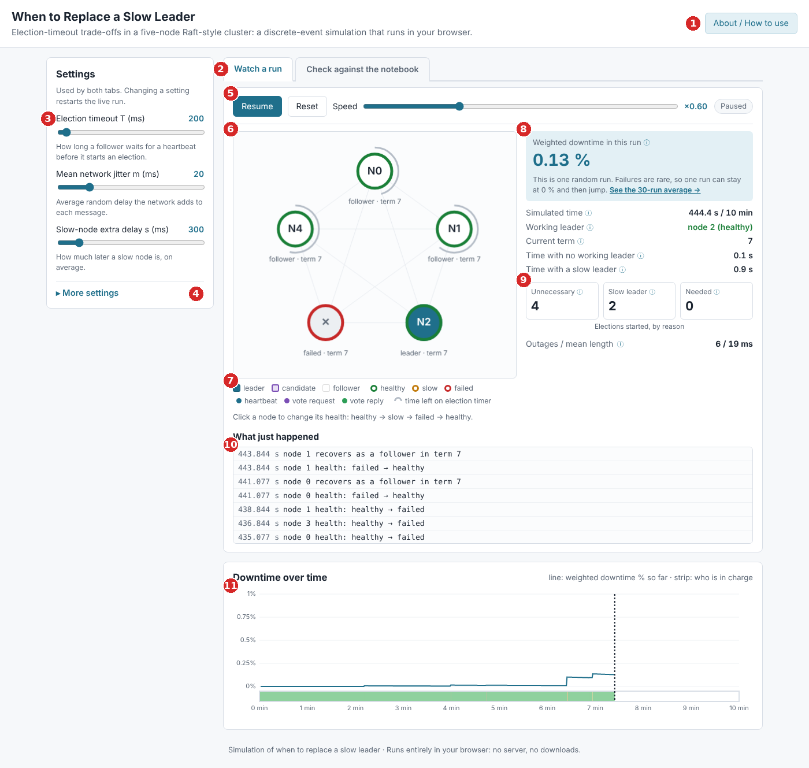

# When to Replace a Slow Leader: Election-Timeout Trade-offs in a Raft-Style Cluster

A discrete-event simulation that finds the election timeout giving a Raft-style cluster the least downtime when its leader can be healthy, slow or failed.

**Live demo:** [oshandas.github.io/raft-election-timeout-simulator](https://oshandas.github.io/raft-election-timeout-simulator/)

[](https://colab.research.google.com/github/OshanDAS/raft-election-timeout-simulator/blob/main/notebook/raft_election_timeout_simulator.ipynb)



## The problem

Distributed databases such as etcd keep their data consistent by electing one **leader** server. The leader sends a short "I am alive" message, a **heartbeat**, to every other server every 100 ms. Each follower runs a countdown called the **election timeout**. If no heartbeat arrives before it ends, the follower assumes the leader is gone and starts an **election**. While there is no working leader, the service cannot accept writes.

Choosing the timeout is a trade-off:

- **Too short:** heartbeats that are only late, because of random network delay (**jitter**), look like a dead leader. The cluster holds many unnecessary elections.
- **Too long:** a crashed leader is replaced slowly, and a leader that is alive but **slow** may never be replaced.

**Question:** which election timeout minimises total service downtime when leaders can be healthy, slow or failed, and how does the best setting change as network jitter increases?

## Quick start

**Notebook, in Google Colab:** click the badge above, then choose **Runtime → Run all**. The notebook runs top to bottom with no manual steps.

**Notebook, on your own computer:**

```bash
pip install -r requirements.txt        # numpy, scipy, matplotlib
jupyter notebook notebook/raft_election_timeout_simulator.ipynb
```

Every random number comes from master seed 42, so repeated runs give identical results on any machine.

**Web demo:** open the [live demo](https://oshandas.github.io/raft-election-timeout-simulator/), or double-click `docs/index.html`. It runs entirely in your browser, with no server, no installation and no internet connection needed. To serve it locally instead:

```bash
python3 -m http.server 8080 --directory docs     # then open http://localhost:8080
```

## User guide

The demo has two tabs:

- **Watch a run:** animates one run. Move the timeout, jitter and slow-node sliders, or click a node to make it slow or failed, and watch the downtime and election counters change.
- **Check against the notebook:** runs many complete runs at once and compares them with the notebook's results. With the reference setting it gives **0.40 ± 0.11 %** downtime, against the notebook's **0.43 ± 0.20 %**, and passes a 95% Welch test.

Full instructions, every control and some things to try: **[USER_GUIDE.md](USER_GUIDE.md)**.

## Model and maths

The model is timing-level: five nodes, heartbeats every $h = 100$ ms, Raft-style terms and majority voting, and no log replication. Full details: **[THEORY.md](THEORY.md)**.

- **Message delay:** every message takes $D = d + J + E$, where $d = 5$ ms is fixed, $J$ is random jitter with mean $m$ (exponential, lognormal or Pareto), and $E$ is an extra delay with mean $s$ that applies only when the sender is slow.
- **Election timer:** each follower draws $T_i \sim \mathrm{Uniform}[T, 2T]$. After a clean leader failure, the first of the four followers times out after $T + T/5 = 1.2\,T$ on average.
- **Elections:** a candidate needs a majority, $\lfloor n/2 \rfloor + 1$ votes, and each node votes at most once per term, so a term can never have two leaders.
- **Node health:** each node follows a discrete-time Markov chain on {healthy, slow, failed}, stepped every second. Its stationary distribution $\pi P = \pi$ gives $\pi = (0.863,\ 0.101,\ 0.036)$.
- **Downtime:** time with no working leader, plus time with a slow leader weighted by $w = 0.5$:

$$
\text{downtime} = t_{\text{no leader}} + w\, t_{\text{slow leader}}
$$

- **Why jitter matters:** for exponential jitter, the gap between two heartbeat arrivals exceeds $\tau$ with probability $\Pr(G > \tau) = \tfrac{1}{2} e^{-(\tau - h)/m}$. More jitter means more long gaps, so a longer timeout is needed.
- **Statistics:** each setting is run 30 times, and results are reported as mean $\pm\ t_{0.975,\,n-1}\, s/\sqrt{n}$ (a 95% confidence interval).

## Verification

The notebook contains **21 automated checks** (section 5). Each one stops the notebook with an error if it fails, and all 21 pass. They include:

- **Analytic comparisons:** delay means, recovery time after a failure, the stationary distribution, and the heartbeat-gap formula.
- **Limiting cases:** a 60-second run with no jitter and no failures gives exactly 601 heartbeats sent, 2400 accepted and 0 elections.
- **Negative controls:** a deliberately broken voting rule must trigger the safety check, and it does.
- **Safety invariant:** never two leaders in one term, tested over more than 2,500 elections.
- **Independent replay:** the downtime meter is recomputed a second, independent way.

The Monte Carlo error also shrinks as theory predicts. The 95% confidence-interval width falls with a fitted slope of −0.56 against the number of replications, close to the theoretical −0.5:


The web demo repeats 8 of these checks in the browser, and agrees with all 42 cells of the notebook's main sweep.

## Concepts applied

- **Discrete-event simulation:** next-event time advance with a future event list, tie-breaking and lazy cancellation of timers.
- **Random variate generation:** inverse-transform sampling for exponential and Pareto delays, lognormal delays from a normal variate, and discrete inverse transform for health states.
- **Discrete-time Markov chains:** the healthy / slow / failed chain per node, its stationary distribution and its mean holding times.
- **Monte Carlo estimation:** independent replications, the law of large numbers, Student-t confidence intervals and $1/\sqrt{N}$ convergence.
- **Variance reduction:** common random numbers, through a separate random stream for each purpose and each node.
- **Comparing alternatives and sensitivity analysis:** Welch intervals to find statistically tied timeouts, and a one-factor-at-a-time sensitivity study.

## Results

Main sweep (notebook section 6.3): 7 timeouts × 3 jitter levels × 2 ways of being slow, 30 runs of 10 simulated minutes each.


| Mean network jitter | Best timeout (both slow models) |
|---|---|
| 5 ms | about 150 ms |
| 20 ms | about 200 ms |
| 50 ms | about 300 ms |

- **The best timeout rises with jitter.** These are best ranges rather than exact values, because some neighbouring timeouts are statistically tied.
- **Too short is very costly under high jitter.** At T = 150 ms with 50 ms jitter there are about 830 unnecessary elections per 10-minute run, and downtime reaches 11.3 %.
- **Too long mainly lets slow leaders stay in charge.** From T = 300 ms to 3000 ms, time with a slow but working leader grows from 1.3 % to 10.6 % of the run. At 3000 ms this is 5.3 of the 6.9 percentage points of downtime, more than the slower recovery from real failures.
- **How a node is slow matters when T is too long.** A leader that stalls before sending heartbeats is replaced up to much longer timeouts than one whose messages are only delayed.
- **The cost given to a slow leader matters.** If a slow leader costs nothing (w = 0), the best timeout changes in 4 of the 6 cases.

### Limitations

- The slow-node delay (s = 300 ms), the health transition matrix and the weight w are assumptions, not measurements from a real cluster.
- The full sweep uses exponential jitter only, and its timeout grid starts at 150 ms, so the true best value at low jitter may be lower.
- Statistically tied timeouts are found with separate 95% comparisons and no multiple-comparison correction.
- The model is timing only: no log replication, no message loss, no network partitions. A new leader counts as working as soon as it is elected, which slightly underestimates downtime.

### Future work

- Use a finer timeout grid, including values below 150 ms and between 300 and 500 ms, where the late-messages model jumps.
- Sweep the slow-node delay s and other health transition matrices, ideally fitted to measurements from a real etcd cluster.
- Run the full sweep with heavy-tailed (Pareto) and lognormal jitter.
- Add message loss, network partitions and log replication, so that leader readiness and the log up-to-date check are modelled.

## Key references

1. D. Ongaro and J. Ousterhout, "In Search of an Understandable Consensus Algorithm," in *Proc. USENIX Annual Technical Conf.*, 2014.
2. etcd documentation, "Tuning" (v3.5). https://etcd.io/docs/v3.5/tuning/
3. A. M. Law, *Simulation Modeling and Analysis*, 5th ed. New York, NY, USA: McGraw-Hill, 2015.

Full list: **[REFERENCES.md](REFERENCES.md)**.

## AI assistance

AI tools (Claude and ChatGPT) were used to help write the documents and code, explain concepts, derive the maths and cross-check results. The code was run and its results checked against the notebook's verification tests. A detailed AI-use log is kept privately in OneDrive.

## Licence and data credits

Code and documents are released under the **MIT Licence**. See [LICENSE](LICENSE).

**Data:** no external datasets are used. All data is synthetic and generated by the simulation itself (see [data/README.md](data/README.md)). The default heartbeat interval (100 ms) and election timeout (1000 ms) follow the etcd documentation, and the election rules follow the Raft paper by Ongaro and Ousterhout.
