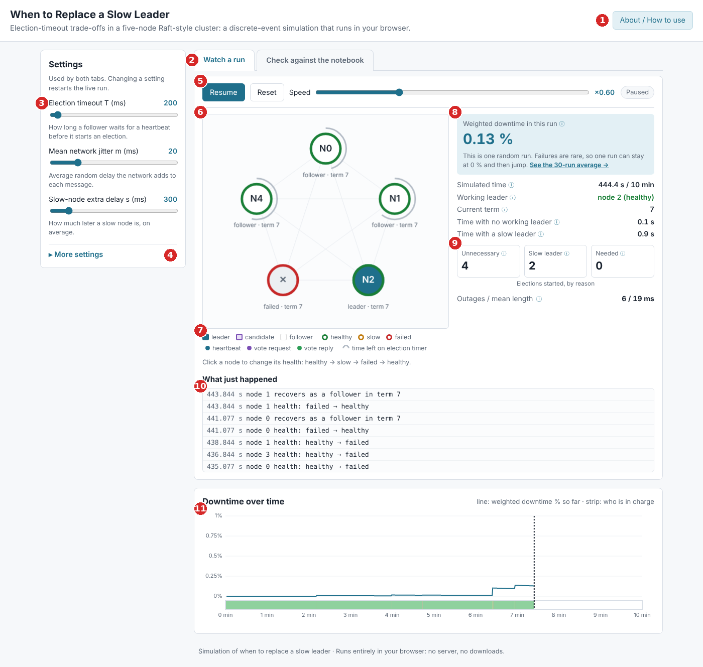
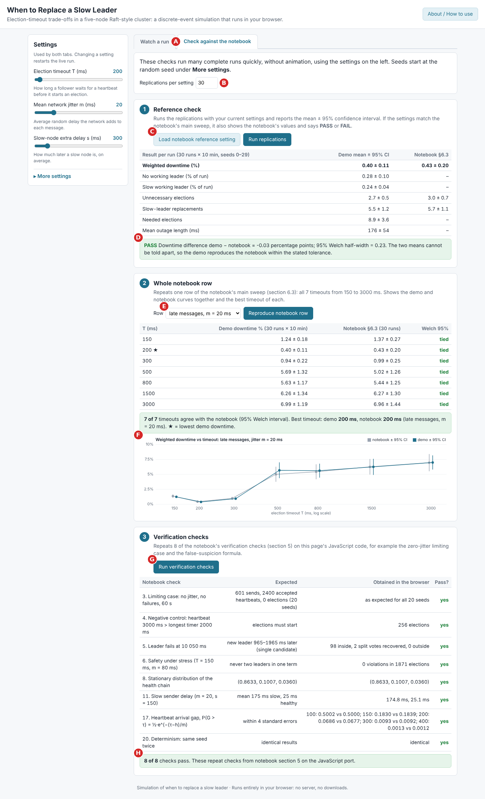

# User guide: When to Replace a Slow Leader web demo

**Open the demo:** [https://oshandas.github.io/raft-election-timeout-simulator/](https://oshandas.github.io/raft-election-timeout-simulator/), or double-click `docs/index.html` in the project folder or ZIP. It runs entirely in your browser (current Chrome, Edge or Firefox), with no server and no internet connection needed. Nothing is installed or uploaded.

The demo runs the same discrete-event simulation as the notebook: a five-node Raft-style cluster where a leader sends heartbeats, followers start elections when their election timeout runs out, and nodes move between healthy, slow and failed. It is a JavaScript port of the notebook model (sections 3 and 4), so the parameters and results mean the same things. See [THEORY.md](THEORY.md) for the equations.

## Layout

The settings are on the left and are shared by both tabs. The page has two tabs:

- **Watch a run:** an animated single run of the cluster.
- **Check against the notebook:** many complete runs at once, compared with the notebook's results.

The **About / How to use** button at the top right opens or closes a short explanation of the model.

### Watch a run tab

| # | Part of the page |
|---|---|
| 1 | About / How to use panel (open or close) |
| 2 | Tabs: Watch a run / Check against the notebook |
| 3 | Main settings: election timeout T, network jitter m, slow-node delay s |
| 4 | More settings (click to open) |
| 5 | Run bar: Start / Pause, Reset, Speed and the run status |
| 6 | Live picture of the cluster (click a node to change its health) |
| 7 | Legend for the picture |
| 8 | Weighted downtime of this run, with a link to the 30-run average |
| 9 | Elections started, by reason |
| 10 | Event log ("What just happened") |
| 11 | Downtime-over-time chart |

### Check against the notebook tab

| Mark | Part of the page |
|---|---|
| A | The tab |
| B | Replications per setting (used by cards 1 and 2) |
| C | Card 1, Reference check: Load notebook reference setting and Run replications |
| D | Result table and PASS / FAIL verdict |
| E | Card 2, Whole notebook row: choose a row and reproduce it |
| F | Chart of the demo and notebook curves |
| G | Card 3, Verification checks |
| H | Verification result |

## Controls

**Main settings (always visible)**

| Control | What it does | Range | Default |
|---|---|---|---|
| Election timeout T | Base election timeout. Each follower's timer is drawn from Uniform[T, 2T] (ms) | 100–3000 ms, step 50 | 200 ms |
| Mean network jitter m | Mean of the random part of each message delay (ms). Ignored when the distribution is "none" | 0–100 ms | 20 ms |
| Slow-node extra delay s | Mean extra delay (exponential) of a slow node, in ms | 0–2400 ms, step 50 | 300 ms |

**More settings (click to open)**

| Control | What it does | Range | Default |
|---|---|---|---|
| Network jitter distribution | Shape of the random network delay added to every message | Exponential, lognormal (σ = 1), Pareto (α = 2.5), none | Exponential |
| How a slow node is slow | *Late messages*: every message a slow node sends is delayed. *Late heartbeats*: a slow leader waits h + Exp(s) before each heartbeat | two modes | Late messages |
| Slow-leader weight w | How much time with a slow leader counts as downtime (0 = not at all, 1 = like no leader) | 0–1, step 0.05 | 0.5 |
| Cluster size | Number of nodes. The majority needed to win an election is ⌊n/2⌋ + 1 | 3 or 5 | 5 |
| Random node health | Turns the healthy / slow / failed Markov chain on or off. When off, every node stays healthy unless you click it | on / off | On |
| Run length | Length of one simulated run, in minutes. Used by the live run and by Run replications | 1–10 min | 10 min |
| Random seed | Seed of the live run, and first seed of the replications (seeds seed, seed+1, …) | 0–99999 | 0 |

Changing any setting restarts the live run with the new value.

**Watch a run tab**

| Control | What it does | Range | Default |
|---|---|---|---|
| Start / Pause | Runs or pauses the live simulation. After a run finishes the button reads Restart | – | – |
| Reset | Clears the run and starts again from time 0 with the current settings | – | – |
| Speed | Simulated time per real second. Messages are drawn only up to ×20. Can be changed at any time without restarting | ×0.05–×200 | ×2 |
| Click a node | Changes that node's health: healthy → slow → failed → healthy. If random health is on, the Markov chain keeps changing it afterwards | – | – |
| See the 30-run average → | Opens the Check against the notebook tab at card 1 | – | – |

**Check against the notebook tab**

| Control | What it does | Range | Default |
|---|---|---|---|
| Replications per setting | Number of independent runs for card 1, and for each timeout in card 2 | 2–100 | 30 |
| Load notebook reference setting | Sets every setting to the reference setting below | – | – |
| Run replications | Runs that many complete runs with the current settings (no animation) and reports mean ± 95% CI | – | – |
| Row / Reproduce notebook row | Re-runs one row of the notebook's main sweep (all 7 timeouts) and plots it against the notebook | 6 rows | late messages, m = 20 ms |
| Run verification checks | Repeats 8 of the notebook's verification checks on the JavaScript code | – | – |

Opening the Check tab pauses the live run. Go back to Watch a run and press Resume to continue it.

## Reading the outputs

**Watch a run**

- **Cluster picture (6):** each circle is a server. The legend underneath (7) explains the symbols.
  - Fill colour shows its role: dark blue = leader, purple = candidate, white = follower.
  - Ring colour shows its health: green = healthy, amber = slow, red with ✕ = failed.
  - The thin grey arc around a follower is the time left on its election timer. It turns orange when less than a quarter of T is left. When it runs out, the follower starts an election.
  - Moving dots are messages: blue = heartbeat, purple = vote request, green = vote reply (grey = vote refused).
  - "Old leader" marks a deposed leader that has not yet heard about the newer term.
- **Weighted downtime in this run (8):** (time with no working leader + w × time with a slow working leader) ÷ simulated time so far, as a percentage. This is the notebook's metric (THEORY.md equation 7). It comes from one random run, and failures are rare, so it can stay near 0 % and then jump. For a reliable value use **See the 30-run average →**.
- **Details under the downtime:** simulated time, the working leader (the leader with the newest term), the current term, the total time with no working leader and the total time with a slow leader.
- **Elections started, by reason (9):**
  - *Unnecessary:* started while a healthy leader was working, usually because jitter made heartbeats late. Many of these mean the timeout is too short.
  - *Slow leader:* started while the leader was slow, so the cluster is replacing a slow leader.
  - *Needed:* started while there was no working leader, for example after the leader failed.
- **Outages / mean length:** the number of completed periods with no working leader, and their average length in ms (the recovery time).
- **ⓘ icons:** point at (or tab to) any ⓘ to see a one-line explanation of that number.
- **Event log (10):** the newest events first, with their simulated time. Matches the story printed in notebook section 4.4.
- **Downtime chart (11):** the line is the weighted downtime % so far. The strip underneath shows who was in charge over time: green = healthy leader, amber = slow leader, red = no working leader. The dashed line marks the current time.

**Check against the notebook**

- **Reference check result (D):** mean ± 95% Student-t confidence interval over the runs, for downtime, time without a leader, time with a slow leader, the three election types and the mean outage length. When the settings match a cell of the notebook's main sweep, the notebook's values are shown next to them with a **PASS / FAIL** verdict.
- **Whole notebook row (E, F):** a table of the 7 timeouts with demo and notebook downtime and whether each pair is "tied" (cannot be told apart). The best demo timeout is marked ★. The chart plots both curves with their confidence intervals.
- **Verification checks (H):** a table of each check with the expected and obtained values and whether it passed.

## Try this

1. **Reproduce the reference result.** Open **Check against the notebook**, press **Load notebook reference setting**, then **Run replications**. After a few seconds the weighted downtime is **0.40 ± 0.11 %** and the verdict says **PASS** (notebook: 0.43 ± 0.20 %).
2. **Too short for the jitter.** With the reference setting loaded, set the mean jitter m to **50 ms** and T to **150 ms**, then press **Run replications**. Downtime jumps to about **11 %**, with about **820 unnecessary elections** per 10-minute run. Late heartbeats now look like a dead leader. Set T to **300 ms** and downtime falls below **1 %**.
3. **Too long, so slow leaders stay in charge.** Load the reference setting, set T to **3000 ms** and run replications. Downtime rises to about **7 %**. Most of it is time with a slow leader that is never replaced. Watch a run on the **Watch a run** tab to see the amber parts of the chart strip.
4. **Two ways of being slow.** Load the reference setting and set T to **800 ms**. Run replications with *Late messages* (about **5.6 %**). Then open **More settings**, switch to *Late heartbeats*, and run again (about **2.2 %**). A leader that stalls before sending is much easier for followers to notice than one whose messages are only delayed.
5. **Watch one election.** Open **More settings**, untick **Random node health** and set the jitter distribution to **None**. Set T to **1000 ms**. On **Watch a run**, press Start at a slow speed (about ×1), then click node 0 twice to fail it. A follower's timer runs out after 1 to 2 seconds, it asks for votes, and it becomes leader of term 2 (compare notebook check 5). Click node 0 again to recover it: it comes back as a follower.
6. **See the whole trade-off curve.** In card 2, choose a row (for example *late heartbeats, m = 50 ms*) and press **Reproduce notebook row**. The chart shows downtime against the timeout for the demo and the notebook, with the best timeout marked ★.

## Check against the notebook

With the reference setting (late messages, exponential jitter m = 20 ms, T = 200 ms, s = 300 ms, w = 0.5, 5 nodes, random health on), **30 runs of 10 minutes starting at seed 0**, the demo gives

> **Weighted downtime 0.40 ± 0.11 %**, against the notebook's **0.43 ± 0.20 %** (notebook section 6.3).

**Tolerance:** the result passes when the two means cannot be told apart by a 95% Welch two-sample interval: |demo − notebook| ≤ the Welch half-width. This is the same test the notebook uses to compare timeouts. Here the difference is −0.03 percentage points against a half-width of 0.23, so it passes. The demo also shows the notebook's unnecessary elections (3.0 ± 0.7, demo 2.7 ± 0.5) and slow-leader replacements (5.7 ± 1.1, demo 5.5 ± 1.2).

The numbers are close but not identical because the demo uses its own random-number generator (xoshiro128**), not NumPy's. That is why a tolerance is needed.

Further consistency checks:

- **Whole notebook row:** with 30 runs from seed 0, all **7 of 7** timeouts agree with the notebook in each of the **6** rows of the main sweep (42 of 42 cells). The best timeout is the same as the notebook's in every row: 150 ms at m = 5 ms, 200 ms at m = 20 ms and 300 ms at m = 50 ms.
- **Verification checks:** **8 of 8** notebook checks pass in the browser:
  - 3: limiting case, 601 sends, 2400 heartbeats, 0 elections
  - 4: negative control
  - 5: new leader 965–1965 ms after a failure
  - 6: safety under stress
  - 8: stationary distribution
  - 11: slow-sender delay
  - 17: false-suspicion formula
  - 20: determinism

## Limitations

- **Same simplifications as the notebook:** timing only, with no log replication, no log check in voting, no message loss and no network partitions. A new leader counts as working as soon as it is elected.
- **Illustrative parameter values:** the health transition matrix, the slow extra delay s and the weight w are assumptions, not measurements from a real cluster. The heartbeat interval (100 ms) and fixed delay (5 ms) are fixed in the demo.
- **Limited reference values:** notebook values exist only for the main-sweep settings: exponential jitter m = 5, 20 or 50 ms, T = 150, 200, 300, 500, 800, 1500 or 3000 ms, s = 300 ms, w = 0.5, 5 nodes, random health on, 10-minute runs. For other settings the demo still runs, but shows no PASS / FAIL.
- **Different random numbers:** the demo's generator differs from NumPy's, so results agree statistically, not digit for digit. With a 95% test, about 1 comparison in 20 can fail by chance even when the model is the same.
- **A single live run is noisy:** failures are rare (the Failed state has a long-run share of 3.6%), so one run's downtime depends heavily on whether the leader happened to fail. Use Run replications before drawing conclusions.
- **Unreliable settings:** at very short timeouts with high jitter (for example T = 100 ms, m = 100 ms), elections happen almost constantly. Replications become slow and the live picture is hard to follow.
- **Messages are not drawn above ×20 speed:** they are too short to see.
